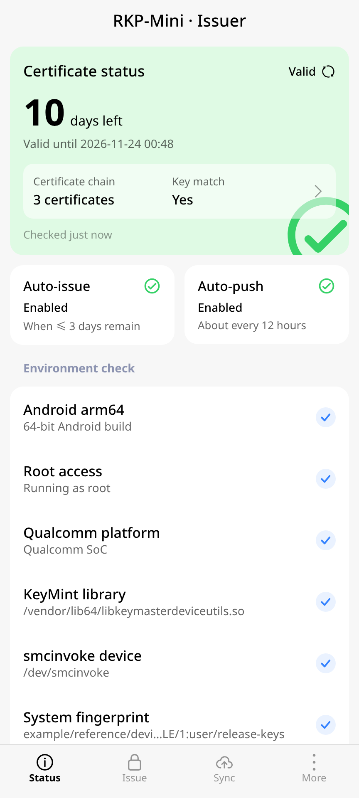
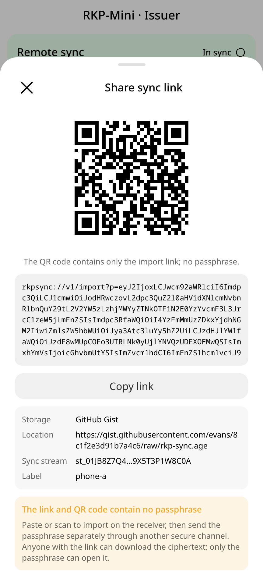
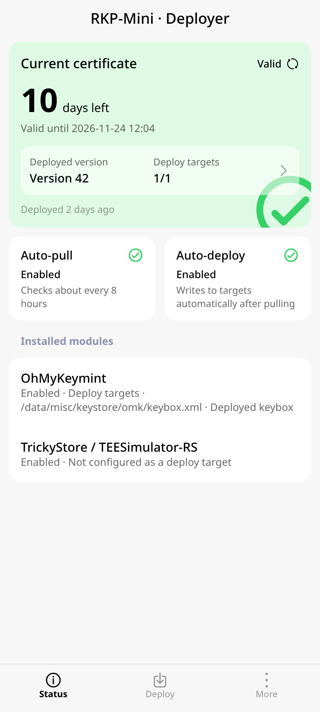
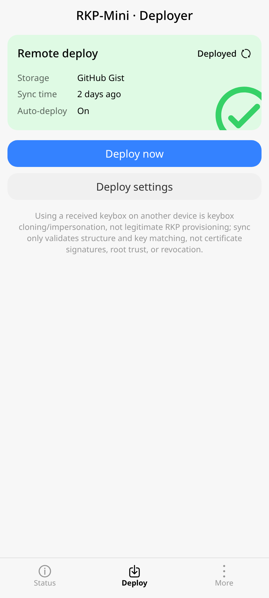

# RKP-Mini

**Issue an Android RKP keybox on a Qualcomm device, and optionally sync it, encrypted, to another one.**

**English** | [简体中文](README_ZH.md)

RKP-Mini is a pair of KernelSU modules with a built-in WebUI. The **Issuer** asks the device's
own Qualcomm KeyMint TA (Native V2, vendor command `0x3122`) to sign a CSR for a fresh P-256
key, requests certificates from the Google RKP service, and writes a TrickyStore-compatible
`keybox.xml`. The **Deployer** receives that keybox on another device and installs it.

> [!WARNING]
> - **Experimental.** Developed against a single Qualcomm reference device (arm64). Other devices and firmware are untested, and no successful on-device issuance has been recorded.
> - **Native V2 only.** Unsupported firmware gets a clear error: no V1/AIDL fallback, no TEE or boot-state spoofing. Passing Play Integrity is not guaranteed.
> - **Remote sync is off by default.** Using a keybox on a different device is keybox cloning/spoofing, not legitimate RKP provisioning. You must accept the risks before it can be enabled.

## Modules

| Module | Install on | What it does |
|---|---|---|
| **RKP-Mini Issuer** (`rkp_mini_issuer`) | The Qualcomm device that issues | Issues and renews the keybox; optionally pushes it, encrypted, to your own GitHub Gist or WebDAV |
| **RKP-Mini Deployer** (`rkp_mini_deployer`) | The device that receives | Fetches, decrypts and checks the keybox, then writes it for OhMyKeymint, TEESimulator, TrickyStore / TEESimulator-RS or a custom path |

The WebUI speaks 简体中文, 繁體中文, English, 日本語, 한국어, Deutsch, Français and Italiano.

## Screenshots

Local simulation previews, not device-verified.

| Issuer status | Sync sharing | Deployer status | Remote sync |
|---|---|---|---|
|  |  |  |  |

## Requirements

- Rooted arm64 device with KernelSU.
- Issuer only: Qualcomm hardware exposing `/vendor/lib64/libkeymasterdeviceutils.so` and `/dev/smcinvoke`, plus network access.
- Deployer only: at least one of the target modules above.

## Install & use

1. Download the ZIP for your role from [Releases](https://github.com/etnperlong/rkp-mini/releases).
   Optional check: `sha256sum --ignore-missing -c SHA256SUMS`.
2. Install it in the KernelSU manager and reboot.
3. Tap **Open** on the module card.

### Issue a keybox

1. **Status** tab: make sure every prerequisite check passes.
2. **Issue** tab → **Issue now**. Issuance runs in the background; you can close the page and come back for the result.
3. The keybox is written to `/data/misc/keystore/rkp-mini/output/keybox.xml`. Copy it to your keystore module, or let the Deployer do it (below).

Qualcomm RKP certificates last only about 12–14 days. Turn on auto-issue under
**Issue → Issue settings** (3 days is recommended) and the module renews in the background.

### Sync to another device (optional)

1. **Sender** (Issuer → **Sync** tab): choose Gist or WebDAV, set an encryption passphrase and the
   Gist token / WebDAV app password, tick every risk item, push, then share the link or QR code.
2. **Receiver** (Deployer): import the link, enter the passphrase (send it over a different
   channel), add a deployment target, tap **Deploy now** and confirm the first version shown.

After that both sides refresh on their own: the Issuer about every 12 h, the Deployer about every 8 h.

- Your storage only ever holds ciphertext; the link and QR code carry the location, never the passphrase.
- Disabling sync or deleting the remote file does **not** revoke a keybox already received. To revoke, change the passphrase **and** issue a new keybox.
- The receiver checks structure, key match and expiry. It does not verify certificate signatures, root trust or revocation.

## Troubleshooting

A failed issuance never replaces the existing keybox. The result sheet shows the stage, error
code and `ta_status`; full logs are under **More → Logs**.

| Error | Meaning |
|---|---|
| `-100` UNIMPLEMENTED | The KeyMint TA lacks command `0x3122` |
| `-18` INCOMPATIBLE_KEY_FORMAT | The TA expects a MacedPublicKey; Native V2 is unavailable |
| `-40` INVALID_TAG | Vendor command/frame mismatch |
| HTTP `444` | Google's RKP service does not recognize the device |

These mean the firmware is not supported; RKP-Mini will not try another protocol.

## Documentation

- [Usage guide](docs/USAGE.md): command line, automation, revocation, migrating from the old `rkp_mini` / `rkp_sync` modules
- [Development](docs/DEVELOPMENT.md): building, testing, releases
- Design records: [remote sync](docs/REMOTE_SYNC_DEVELOP.md), [WebUI](docs/WEBUI_DEVELOP.md)

## Acknowledgements

- [Duck ToolBox](https://github.com/eltavine/Duck-ToolBox): its device RKP issuer is the model for the issuance flow here.
- [TeeForge-CD](https://github.com/mcxiaochenn/TeeForge-CD): its slimmed-down take on Duck ToolBox's issuance was the reference for keeping this project minimal.

## License

[MIT](LICENSE) © 2026 Evans Mike
